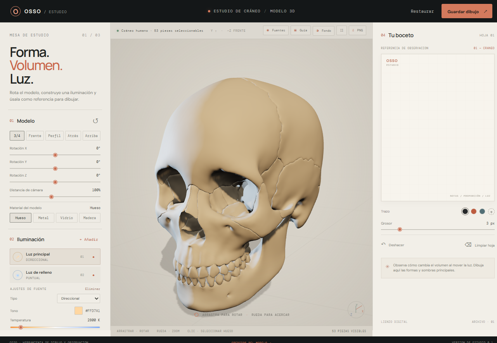

# OSSO · Craneo Studio

Visor 3D interactivo de un craneo humano con herramientas de dibujo y observacion.
Construido con **Three.js + Vite** (sin framework).



## Para que sirve

Herramienta de **estudio anatomico y dibujo** (estilo mesa de trabajo):

- **Centro — visor 3D:** gira el craneo con el raton, encuadra con presets de camara y selecciona cualquiera de sus 53 piezas.
- **Panel izquierdo — forma y luz:** rota el modelo, cambia el material (hueso, metal, vidrio, madera), añade fuentes de luz arrastrables y ajusta su **temperatura en Kelvin** (cálido 2000 K → frio 10000 K) y color de fondo del visor.
- **Panel derecho — tu boceto:** una hoja de dibujo para esquiar el craneo como referencia de observacion (trazo, grosor, deshacer, limpiar).
- **Exportar:** el boton *PNG* guarda la pose actual con **fondo transparente** para usarla en tus diseños.

Ideal para estudiantes de arte, anatomia o odontologia que quieren un modelo de referencia girable con iluminacion controlable.

## Requisitos

- Node.js 18+ (recomendado 20+)
- npm

## Uso

```bash
npm install     # instalar dependencias
npm run dev     # desarrollo -> http://localhost:5173
npm run build   # generar build de produccion en dist/
npm run preview # servir el build en local
```

## Funciones

- **53 piezas seleccionables** del craneo (modelo anatomico de Mariano Coretti)
- **4 materiales**: hueso (textura CC0), metal, vidrio y madera
- **Iluminacion** con fuentes arrastrables y **temperatura de color en Kelvin** (2000-10000 K, presets 3000-8000 K)
- **Color de fondo** configurable con presets y selector personalizado
- **Exportar PNG con fondo transparente** (boton *PNG*, elige carpeta o se guarda en Descargas)
- Presets de camara (3/4, Frente, Perfil, Atrás, Arriba), sliders de rotacion y reset
- Hoja de dibujo (boceto) con deshacer/limpiar

## Estructura

```
index.html          entrada
src/main.js         toda la logica de la app (escena, luces, materiales, export)
src/style.css       estilos
public/models/      GLB del craneo + licencia
public/textures/    textura de hueso (Poly Haven, CC0)
archive-models/     modelos de referencia
```

## Licencias y creditos

- **Modelo 3D**: "High quality skull" de **Mariano Coretti** — [CC BY 3.0](https://creativecommons.org/licenses/by/3.0/). Atribucion requerida: *Created by Mariano Coretti.*
- **Textura de hueso**: "White Stucco" de [Poly Haven](https://polyhaven.com/) — **CC0** (libre de derechos).
- Interfaz y codigo: independientes del modelo anatomico.
